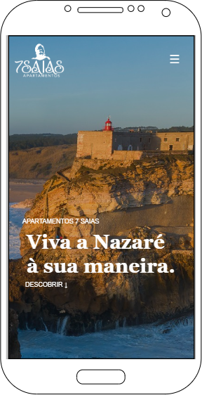
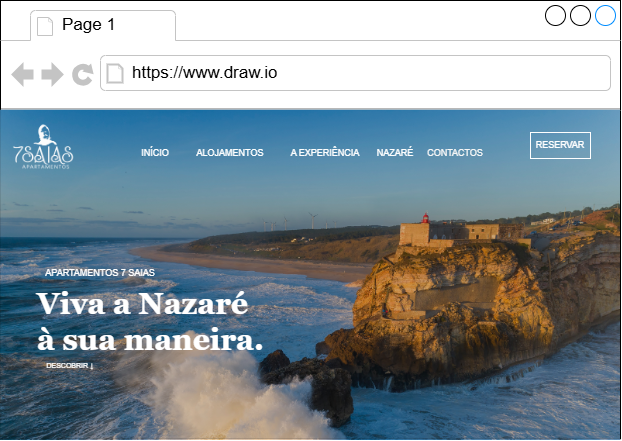
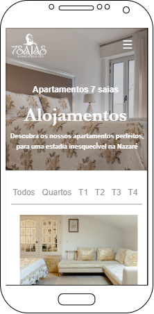
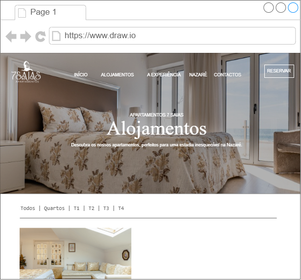

# Apartamentos 7 Saias

Website de reservas dos Apartamentos 7 Saias, na Nazaré.

Projeto da unidade curricular **Desenvolvimento para a Web**, da Licenciatura em Ciência de Dados para a Gestão (Coimbra Business School | ISCAC), ano letivo 2026/2027.

## Grupo

| Nº | Nome |
|---|---|
| 2024145138 | Lara Bem Veríssimo |
| 2024134502 | Tomás Teixeira Roque Bernardes |

## O projeto

Os Apartamentos 7 Saias têm quartos e apartamentos (T1 a T4) no centro da Nazaré, perto da praia. O nome vem da tradição das sete saias das mulheres da Nazaré.

O website permite conhecer os alojamentos, a vila e a forma de funcionamento da receção, e fazer a reserva diretamente, sem passar por plataformas externas.

## Páginas principais (Entrega 2)

Para esta entrega, as páginas a avaliar são:

- **Início** (`index.html`)
- **Alojamentos** (`alojamentos.html`)
- **Nazaré** (`nazare.html`)

As restantes páginas também estão completas e fazem parte do projeto.

## Estrutura do website

```
Menu: Início | Alojamentos | A Experiência | Nazaré | Avaliações | Contactos | [Reservar] | PT/EN

Início ......................... apresentação, alojamentos em destaque e acesso à reserva
├── Alojamentos ................ quartos e apartamentos, com filtros por tipo e favoritos
│   ├── Detalhes ............... fotografias, comodidades, preço, mapa e avaliações
│   └── Espaços comuns ......... fotografias dos espaços comuns do edifício Millennium
├── A Experiência .............. comodidades, informações úteis e como reservar
├── Nazaré ..................... a vila, o que visitar, a lenda e quando visitar
├── Avaliações ................. opiniões dos hóspedes, com média e filtro por estrelas
├── Contactos .................. telefone, e-mail, mapa da receção e perguntas frequentes
└── Reservar ................... pesquisa por datas e pessoas, dados do cliente e confirmação

Administração (admin.html) ..... área reservada, acessível pelo rodapé
```

## Funcionalidades

### Básicas

- Design responsivo para telemóvel, tablet e computador
- Menu que, no telemóvel, ocupa o ecrã inteiro
- Website em português e inglês
- Lista dos alojamentos com filtros por tipo (Quarto, T1, T2, T3 e T4)
- Página de cada alojamento com galeria, descrição, capacidade, comodidades, preço e localização
- Consulta da disponibilidade por datas, tipo de alojamento e número de pessoas
- Reserva com cálculo do valor da estadia
- E-mail de confirmação da reserva, com a referência, as datas e o valor a pagar
- Formulário com validação (campos obrigatórios, e-mail e telefone com indicativo do país)
- Avaliações e comentários dos hóspedes
- Área de administração para gerir reservas, alojamentos e avaliações

### Extras

- Códigos promocionais
- Desconto automático para clientes habituais
- Lista de favoritos, guardada no browser
- E-mail de aviso quando uma reserva é cancelada
- Estatísticas na área de administração (reservas, receita e avaliações)

## Responsividade

O site foi feito a partir do telemóvel (*mobile first*) e adapta-se com os pontos de quebra do Tailwind (`sm`, `md`, `lg` e `xl`). Alguns exemplos:

- Grelhas de cartões com 1 coluna no telemóvel, 2 no tablet e 3 ou 4 no computador
- Secções em duas colunas (texto e fotografia) que ficam empilhadas no telemóvel
- Barra de filtros dos alojamentos que desliza para o lado em ecrãs pequenos
- Tabelas da administração com deslocamento horizontal no telemóvel

Foi testado a 360, 768, 1024 e 1440 píxeis de largura.

## Esquemas

Os esquemas da Entrega 1 foram feitos no [draw.io](https://app.diagrams.net) e estão na pasta [`esquemas/`](esquemas/).

### Página inicial · Mobile


### Página inicial · Desktop


### Alojamentos · Mobile


### Alojamentos · Desktop


## Código

### Tecnologias

- **HTML5**: estrutura das páginas (`header`, `main`, `section`, `footer`)
- **Tailwind CSS 3.4.17** (CDN): estilos e responsividade
- **JavaScript**: menu, idiomas, filtros, favoritos, galeria, pesquisa e reserva
- **PHP + SQLite**: alojamentos, disponibilidade, reservas e avaliações
- **PHPMailer**: e-mails de confirmação e cancelamento pelo Gmail
- **Iconify** (Heroicons e Lucide): ícones, em `icones.css`

### Como abrir

É preciso ter o PHP instalado, com as extensões `pdo_sqlite`, `sqlite3`, `mbstring` e `openssl` ativas no `php.ini`.

Na pasta do projeto:

```
php -S localhost:8000
```

Depois abrir http://localhost:8000 no browser.


### Organização das pastas

```
projeto-web-php/
├── index.html                       Início
├── alojamentos.html                 Alojamentos
├── detalhes.html                    Detalhes de um alojamento
├── espacos-comuns-millennium.html   Espaços comuns
├── experiencia.html                 A Experiência
├── nazare.html